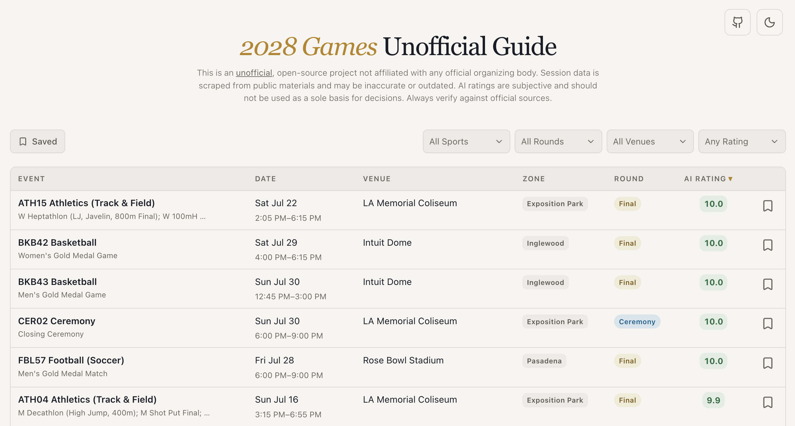

> **Disclaimer:** This is an unofficial, open-source project and is not affiliated with, endorsed by, or connected to any official games organizing body. Session data is scraped from publicly available schedules and materials and may be inaccurate, incomplete, or outdated. Always verify details against official sources before making any plans or purchasing decisions. Use at your own risk.

# 2028 Games Unofficial Session Guide

[][lighthouse-report]
[][lighthouse-report]
[][lighthouse-report]
[][lighthouse-report]
[][lighthouse-report]
[][lighthouse-report]
[][lighthouse-report]

[lighthouse-report]: https://googlechrome.github.io/lighthouse/viewer/?jsonurl=https://raw.githubusercontent.com/tompiarulli/2028-games-guide/badges/report.json

After being selected for the Los Angeles 2028 Summer Games local presale, I found myself overwhelmed when trying to buy tickets. Browsing the 800+ sessions was cumbersome, and most sources didn't have much information beyond competition names.

I worked with Claude to research and create full summaries and rankings for every event (see [AI Ratings Methodology](#ai-ratings-methodology)). It was so helpful I decided to expand it into an open-source project and [share it on r/olympics](https://www.reddit.com/r/olympics/comments/1sjin2n/i_created_a_session_browser_with_autogenerated/). I hope it helps you too!

## Resources Used

- [2028 Session Table](https://docs.google.com/spreadsheets/d/1bJJc__Bt_VgBkZw3jZAMHKmoP3Q5Wdq5I9sA4vzLsws/htmlview?gid=798256147&pru=AAABnY8tXA0*s67VGSR_thwjEPBNJ8734g#gid=798256147) (Google Sheets) — primary source of session data.
- [Official competition schedule](https://la28.org/content/dam/latwentyeight/competition-schedule-imagery/uploaded-nov-12-2025/LA28OlympicGamesCompetitionScheduleByEventV2.pdf) (PDF) — used to cross-reference and verify session data against the officially published schedule.

## Special Thanks

- [u/type*rex*](https://www.reddit.com/r/olympics/comments/1sc3a21/la28_google_doc_session_codes_current_prices_and/) — for the session table Google Sheet.
- [u/polygon06](https://www.reddit.com/r/olympics/comments/1scjk1s/interactive_la28_schedule_explorer/) — whose schedule explorer inspired me to share this project.

## AI Ratings Methodology

Sessions are scored by an AI pipeline (`pnpm generate-content`) that grounds each session in up-to-date facts, writes a blurb, then produces a scorecard across five dimensions. The methodology is opinionated: it is meant to surface interesting sessions, not to be official or authoritative. Sessions that haven't been scored yet still appear in the schedule but don't display a scorecard.

### Dimensions and weights

Every dimension is scored on a 1–10 scale. The **aggregate** is a weighted average of the five (shown in the UI to one decimal place).

| Dimension        | Weight | What it reflects                                                                                                          |
| ---------------- | ------ | ------------------------------------------------------------------------------------------------------------------------- |
| **Significance** | 30%    | How much the session matters in context: round type (e.g. gold medal vs preliminary), sport stakes, multi-medal sessions. |
| **Experience**   | 25%    | How strong the live-watch experience is likely to be: sport watchability, venue, round importance, prime-time slotting.   |
| **Star power**   | 15%    | Likelihood of globally recognized athletes competing in this session.                                                     |
| **Uniqueness**   | 15%    | Rarity of the opportunity: new/returning sports, iconic venue pairings, ceremonies.                                       |
| **Demand**       | 15%    | How hot tickets are likely to be: sport-level demand, round, standout "cultural moment" combinations.                     |

## Tech Stack

- **App:** [TanStack Start](https://tanstack.com/start) (React 19, server-side rendering, file-based routing) with TanStack Router, Query, and Virtual. Built with Vite and [Nitro](https://nitro.build).
- **UI:** Tailwind CSS v4, [Base UI](https://base-ui.com), and Lucide icons.
- **Content pipeline:** TypeScript scripts that use the [Perplexity](https://www.perplexity.ai) API for grounded research and the [Anthropic](https://www.anthropic.com) API for writing and scoring. They use prompt caching and batch requests to keep costs down.
- **Quality:** strict TypeScript, Vitest and Testing Library, oxlint and oxfmt, and Lighthouse CI budgets on every pull request.
- **Delivery:** GitHub Actions, Release Please (versioning and changelog driven by conventional commits), Renovate, and Vercel (hosting, Web Analytics, Speed Insights).
- **Development:** [Claude Code](https://claude.com/claude-code) for AI-assisted development. Its project instructions are committed in [`AGENTS.md`](AGENTS.md).

### Content guardrails

Session blurbs and ratings are generated by LLMs, so the pipeline has guardrails:

- **Grounded:** each session, sport, and venue is first researched with sources. The writing and scoring stages work only from that research. Paris 2024 medal results scraped from Olympedia serve as the authoritative record.
- **Staged:** grounding, writing, and scoring are separate scripts, each with its own output. Any one stage can be rerun for a single session without touching the others.
- **Correctable:** hand-written correction files (per session, sport, or venue) are fed into every regeneration. A fix I make once stays fixed.
- **Reviewable:** all generated content is committed, so every change to a blurb or score shows up in a diff.

## Performance

Every pull request runs [Lighthouse CI](lighthouserc.json) against the production build on a throttled mobile profile, and the check fails if any page misses its budget. In production, [Vercel Speed Insights](https://vercel.com/docs/speed-insights) records real-user Core Web Vitals.

The badges at the top come from a mobile Lighthouse run against the live home page, refreshed after every release and weekly ([workflow](.github/workflows/lighthouse-badges.yml)). Each badge links to the full report.

**Budgets:** accessibility, best practices, and SEO must score 100 on every page, with CLS ≤ 0.1 and TBT ≤ 200 ms. Home and static pages also need performance ≥ 95 and LCP ≤ 2.5 s. Session deep links are the slowest page because the session drawer mounts after hydration, so their budget is performance ≥ 85 and LCP ≤ 4 s.

**What keeps scores high:**

- Every URL is server-rendered and cached at the CDN (`s-maxage` 1 hour, `stale-while-revalidate` 1 day). Static pages are prerendered.
- Session data is bundled into the server function, so there's no database round trip, and the client only fetches the rows or the single session it shows.
- Nothing blocks first paint: the CSS is inlined into the document, and an inline script applies the saved theme.
- The first page renders 20 sessions, which keeps the DOM and embedded data small, and infinite scroll loads the rest.
- The document preloads route code, so there's no request waterfall. The side drawers and report dialog load as separate chunks during hydration.
- Hashed assets are cached immutably for a year.
- Client-only state (saved sessions in `localStorage`) loads after hydration, and session data never goes stale on the client, so React never throws away the server HTML.
- Theme colors meet WCAG AA contrast (4.5:1) in both light and dark mode.

Run it locally with `pnpm build && pnpm lighthouse`. HTML reports are written to `.lighthouseci/reports`.

## Contributing

See [CONTRIBUTING.md](CONTRIBUTING.md) for development setup and guidelines.

## License

[MIT](LICENSE)
